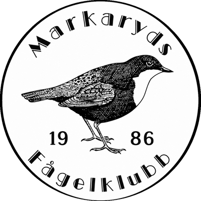
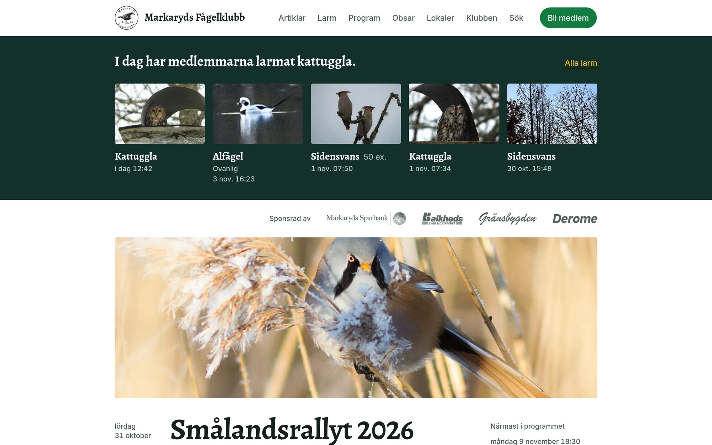
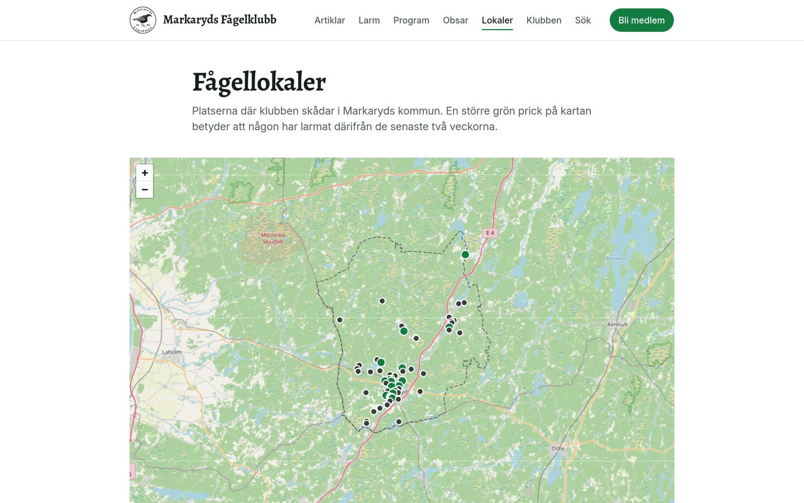
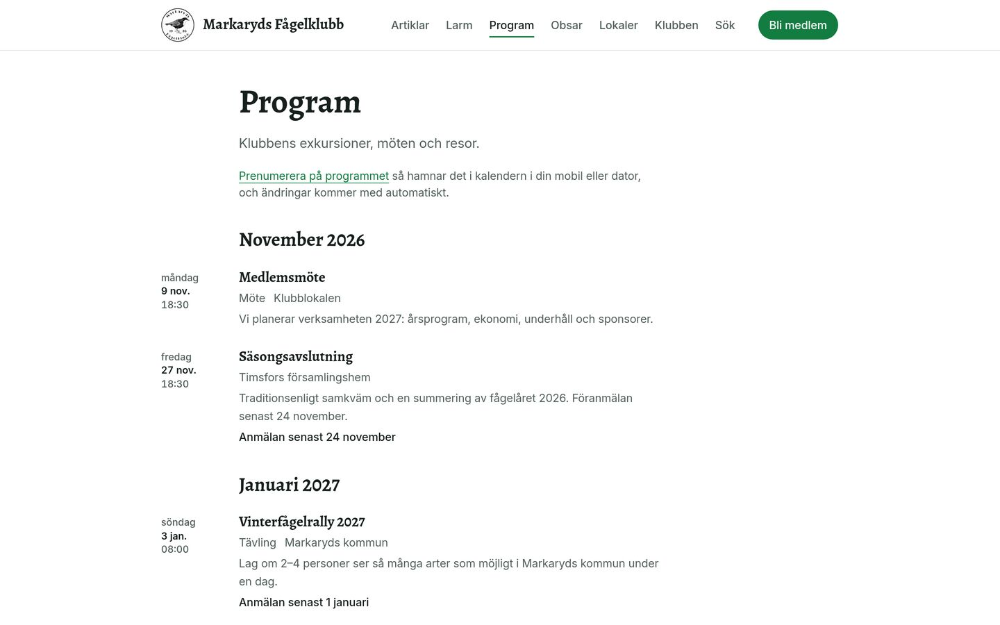
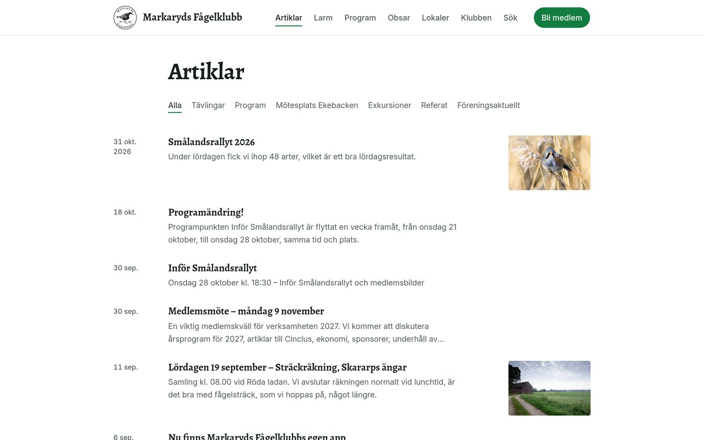
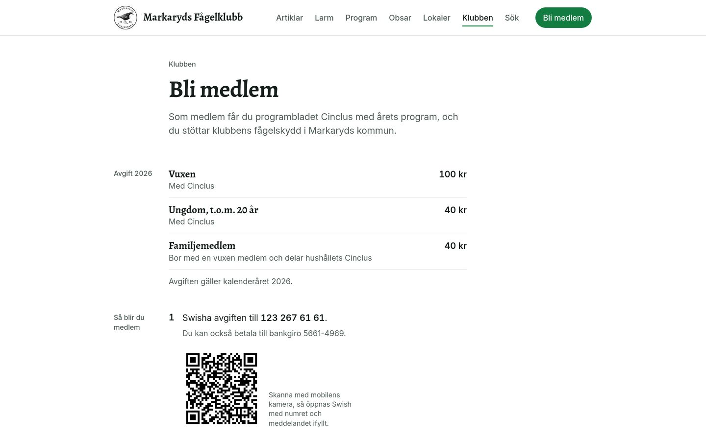

<p align="center">
  <a href="https://mafk-web.jonas-268.workers.dev">
    
  </a>
</p>

<p align="center">
  The website of Markaryds Fågelklubb, the bird club of Markaryds kommun since 1986.<br>
  Astro on Cloudflare Workers, rendered from the Supabase database it shares with the club's app.
</p>

<p align="center">
  <a href="https://mafk-web.jonas-268.workers.dev"><b>mafk-web.jonas-268.workers.dev</b></a> ·
  <a href="https://github.com/YunusAndreasson/markarydsfagelklubb">The app</a> ·
  <a href="#run-it-locally">Run it locally</a> ·
  <a href="docs/">Docs</a>
</p>

<p align="center">
  <a href="https://github.com/YunusAndreasson/markarydsfagelklubb.nu/actions/workflows/ci.yml"></a>
  <a href="LICENSE"></a>
</p>

<br>



It replaces the club's WordPress site at
[markarydsfagelklubb.nu](https://markarydsfagelklubb.nu), which stays up until
the domain moves over; until then every page carries `noindex`. The site is in
Swedish, like the club.

## Features

- **Larm.** The birds members report in the
  [club's app](https://github.com/YunusAndreasson/markarydsfagelklubb), as
  today's species on the home page and in full under Larm. A place is published
  as the nearest lokal within 3 km, or as the kommun, never as a coordinate,
  because many reports come from members' own gardens. Names are read from the
  members' profiles on every request, so someone who deletes their account
  stops being named.
- **Program.** The club's excursions, meetings and trips, also as a calendar
  feed (`/kalender.ics`), so a changed date reaches members' calendars without
  anyone sending it round.
- **Lokaler.** The places where the club watches birds, on an OpenStreetMap
  map. A lokal with a larm in the last two weeks gets a larger green pin.
- **Artiklar.** 353 posts from the WordPress site, 2010 to 2026, imported with
  their photos. Old URLs answer with a 301 to the new address, so links in old
  emails and search results still land.
- **Bli medlem.** The year's fees, entered once in the admin area and printed
  wherever the site mentions them, with a Swish QR code for paying from a
  computer.
- **Sök.** Swedish full-text search in Postgres, plus a match anywhere in a
  title, since the stemmer won't find "uggla" in "sparvuggla".
- **One login.** Only the club's administrator signs in, at `/admin`, to edit
  articles, pages, the programme, lokaler and fees. Public pages read with the
  publishable key, so they see what row-level security gives any visitor, and
  only the map pages send JavaScript.

<table>
  <tr>
    <td width="50%"></td>
    <td width="50%"></td>
  </tr>
  <tr>
    <td align="center"><sub><b>Lokaler</b>, green where a larm came in lately</sub></td>
    <td align="center"><sub><b>Program</b>, also a calendar feed</sub></td>
  </tr>
  <tr>
    <td width="50%"></td>
    <td width="50%"></td>
  </tr>
  <tr>
    <td align="center"><sub><b>Artiklar</b>, back to 2010</sub></td>
    <td align="center"><sub><b>Bli medlem</b>, fees from the admin area</sub></td>
  </tr>
</table>

## Run it locally

You need Node 22.12 or newer (CI runs 26.13) and pnpm 11, the version in
`package.json`'s `packageManager`.

```sh
pnpm install
pnpm dev        # http://localhost:4321
```

The dev server reads the club's live database with the publishable key, which
is public and lives in `wrangler.jsonc`, so most pages need no setup. Larm
are read with a Worker secret that only the deployed site holds, so locally
the home page leaves out its larm band, and Larm and Lokaler show the error
page.

`pnpm verify` runs what CI runs: Biome, `astro check`, Vitest and the build.
`pnpm preview` builds the site and serves it from the real Worker, headers and
redirects included. Production ships from the maintainer's machine, never from
CI, and migrations are applied by hand, because the app's members are on the
same database.

## Docs

- [Roadmap](docs/roadmap.md): the steps the site was built in, and every
  decision with its date
- [Design](docs/design.md): the public pages, and why they look the way they do
- [The shared database](docs/shared-database.md): read it before any schema or
  Supabase work
- [The WordPress import](docs/wp-import.md)
- [CLAUDE.md](CLAUDE.md): the conventions, for agents and people

## Under the hood

- [Astro](https://astro.build) and its
  [Cloudflare adapter](https://docs.astro.build/en/guides/integrations-guide/cloudflare/),
  on [Cloudflare Workers](https://developers.cloudflare.com/workers/)
- [Supabase](https://supabase.com) for Postgres, auth and storage, shared with
  the app
- [Tiptap](https://tiptap.dev) for the admin's editor, and
  [sanitize-html](https://github.com/apostrophecms/sanitize-html) on save
- [shadcn/ui](https://ui.shadcn.com) on [Base UI](https://base-ui.com), with
  [Tailwind CSS](https://tailwindcss.com)
- [Leaflet](https://leafletjs.com) and
  [OpenStreetMap](https://www.openstreetmap.org) for the maps
- [Alegreya](https://github.com/huertatipografica/Alegreya) and
  [Inter](https://rsms.me/inter/), self-hosted through
  [Fontsource](https://fontsource.org)
- [Biome](https://biomejs.dev) and [Vitest](https://vitest.dev) for the checks

## License

The code is [MIT](LICENSE). The club's name, emblem and texts belong to
Markaryds Fågelklubb, the photos to the members and others who took them, and
the sponsors' logos to the sponsors; [NOTICE.md](NOTICE.md) lists the paths.
